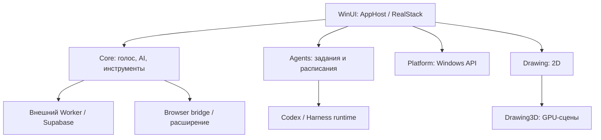

# Архитектура восстановленной Windows-сборки

Основано на извлечённом коде версии 1.1.3. Наличие реализации не означает проверенную работу функции. Это C#/.NET 9, WinUI 3 и Win32, а не Electron. Для восстановления используется SDK .NET 10: декомпилятор выводит C# 14.

| Модуль | Ответственность | Основные точки входа |
| --- | --- | --- |
| HeyClicky | WinUI-приложение: запуск, окна, док, плавающая панель, настройки, onboarding, wiring | `HeyClicky.App.Program`, `App`, `AppHost`, `RealStack` |
| HeyClicky.Contracts | Общие интерфейсы, координаты, модели событий, ввод/вывод, сервисы захвата и рисования | `IScreenCaptureService`, `IMicrophoneCapture`, `IScreenDrawingCanvas`, `ShellOpenRules` |
| HeyClicky.Core | Голосовой диалог, AI-протокол, диктовка, документы, настройки, auth, billing, browser bridge, MCP | `CoreServices`, `CompanionSession`, `BrainSession`, `WorkerClient`, `CompanionTools` |
| HeyClicky.Agents | Фоновые задания, сессии и результаты, исполнение через harness/Codex, расписания | `AgentService`, `CodexRpcClient`, `RoutineScheduler`, `ClickyJobStore` |
| HeyClicky.Platform | Интеграция с Windows: звук, захват экрана, ввод, горячие клавиши, окна и оверлеи | `ScreenCaptureService`, `WasapiAudioOutput`, `ShortcutMonitor` |
| HeyClicky.Drawing | 2D-отрисовка, текст, изображения, звук, анимации и графические карточки | `ScreenDrawingCanvas`, `NativeEngine`, `ScreenPainter` |
| HeyClicky.Drawing3D | 3D-сцены, геометрия, материалы, камера, GPU-пайплайны | `Scene3D`, `FigureRenderer`, `Pipelines` |

## Связи

`Contracts` предоставляет общие интерфейсы модулям. Главный процесс создаёт сервисы в `RealStack`; интерфейс и системные сервисы соединены делегатами и интерфейсами. Зависимости между собственными модулями восстановлены как `ProjectReference`.

## Поток голосового запроса

Микрофон → захват PCM → транскрипция → `CompanionSession` → `BrainSession` / HTTP и SSE → текст, речь или вызов инструмента → локальное действие, browser bridge или фоновый агент → результат и обновление интерфейса. `BrainSseParser` разбирает поток по частям, `BrainToolRunner` собирает результаты вызовов.

## Браузер

Расширение Chromium Manifest V3 содержит service worker, popup и скрипты страницы. Использует debugger, tabs, native messaging, storage, alarms, tab groups и downloads. Клиент реализует мост, локальные HTTP/MCP endpoints и набор операций: вкладки, открытие URL, snapshot, extract, click, fill, press, scroll, batch, upload/download, dialog, screenshot, JavaScript и операции по координатам. Подключение браузера и существующая пользовательская сессия требуются отдельно.

## Рисование и UI

Главный UI построен на WinUI. `NativeEngine` запускает извлечённые JS-файлы через ClearScript/V8 и передаёт команды нативному painter. 3D использует Vortice/Direct3D. Это не означает, что весь интерфейс написан на JavaScript. WebView2 используется, в частности, для снимков веб-страниц (`WebPageSnapshotter`).

## Локальные данные и сеть

Есть файловые хранилища настроек, истории/заданий, рабочих папок и артефактов. Auth-клиент использует Supabase, HTTP-клиент — внешний Worker API. Реализованы OAuth/MCP, WebSocket/realtime, SSE, telemetry, обработка лимитов и подписки. Секреты серверных провайдеров и исходники Worker в установщике не найдены. Публичные клиентские настройки не заменяют серверную реализацию.

## Границы восстановления

Восстановлен Windows x64 клиент. Наличие классов с историческим названием `MacStep` не подтверждает восстановление macOS-приложения. XAML-метаданные и программный UI доступны в C#, но оригинальная разметка XAML и нативные runtime-компоненты не восстановлены как исходники. Скомпилированные ресурсы и сторонние библиотеки берутся из проверенного установщика.
